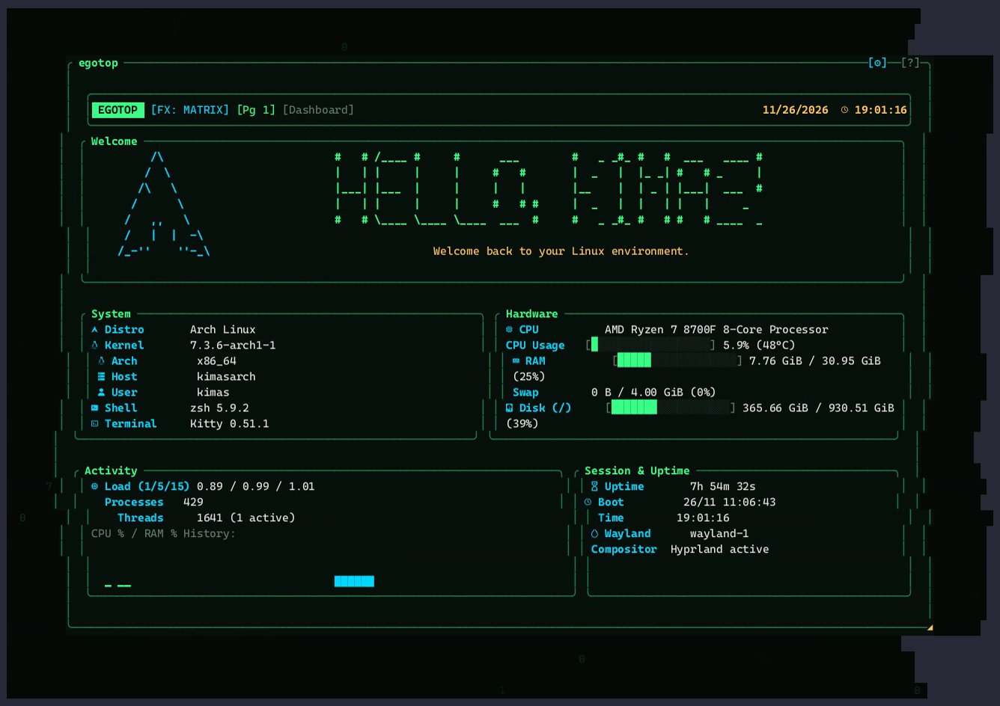

# egotop

An interactive, animated terminal welcome dashboard for Linux and Hyprland written in Rust.

**egotop** combines native Linux system inspection with an independent window engine, startup transitions, ambient background effects, FIGlet ASCII typography, runtime border customization, and a Neovim-style command line with contextual autocomplete.

---

## Demonstration

- Demonstration video: [`assets/demo.mp4`](assets/demo.mp4) (recorded directly from a live `egotop --startup cursor` terminal session)



---

## Implemented Features

- **Native Linux System Information**: OS release, kernel, architecture, hostname, user, shell and version, terminal emulator, DE/WM (`Hyprland`, `Sway`, `i3`), Wayland/X11 session, CPU usage & temperature (`/proc/stat`, `hwmon`), RAM & Swap (`/proc/meminfo`), mounted disks (`statvfs`), GPU/VRAM (`/sys/class/drm`), load average, processes, threads, uptime, and real-time CPU/RAM sparklines.
- **Window Engine**: Independent main window (`~/.config/egotop/window.toml`) with relative anchors, absolute coordinates, mouse drag (top border), bottom-right resize handle (`◢`), z-index ordering, configurable borders, padding, and solid or terminal-cell transparent (`Color::Reset`) backgrounds.
- **Command-line & Contextual Autocomplete (`:`)**: Hidden until `:` is pressed; shell-style `Tab` / `Shift+Tab` cycling immediately updates the active token without requiring `Enter`, `Space` advances to argument completions, and `Enter` executes.
- **Runtime Border & Theme Customization**: Switch colorschemes (`:colorscheme <name>`) or customize border styles and individual characters (`:set border.horizontal ━`, `:set border.style double`) immediately in runtime, then persist explicitly with `:write` (`:w`).
- **Unified Animation, Scene & Background Engine**: One declarative engine powers both bundled presets and external community packages (`~/.config/egotop/animations/<name>/animation.toml` + `assets/`): multi-layer scenes, Unicode Braille/Quadrant/ASCII geometry with smooth 64-point contour morphing (`circle -> square -> triangle -> polygon -> path`), keyframe timelines (`linear`, `ease_in`, `ease_out`, `ease_in_out`, `cubic_bezier`), `once`/`infinite`/`repeat`/`ping_pong` loops, 9 text animation effects (`typewriter`, `fade`, `reveal`, `wave`, `glitch`, `color_cycle`, `char_by_char`, `scroll`, `pulse`), and composable multi-layer backgrounds (`matrix_rain`, `starfield`, `particles`, `waves`, `noise`, `gradient`, `floating_chars`, `custom_ascii`, `scanlines`). Includes rich showcases such as `shape-morph`, `orbital-prism`, `neon-banner`, `aurora-horizon`, `matrix-overload`, `starlight-warp`, and `pulse-scanner`.
- **ASCII Typography & Logos**: Built-in fonts (`ANSI Shadow`, `Standard`, `Big`, `Slant`, `Small`, `Block`, `Doom`), custom `.flf` FIGlet font loader with horizontal kerning/smushing, built-in and custom ASCII logos, and Nerd Font / pure ASCII fallback support.

---

## Requirements

- Linux (`x86_64` or `aarch64`)
- Rust toolchain (`rustc` / `cargo`, edition 2024; verified with `rustc 1.96.0`)
- Terminal emulator with truecolor support recommended (Kitty, Alacritty, WezTerm, foot)
- Optional: a Nerd Font for icons (set `use_nerd_fonts = false` or `ascii_fallback = true` if unavailable)

---

## Installation

Clone and build from source:

```bash
git clone https://github.com/kiammota/egotop.git
cd egotop
cargo build --release
```

Run directly:

```bash
./target/release/egotop
```

Or install into `~/.cargo/bin`:

```bash
cargo install --path .
```

---

## Quick Start

Launch with defaults (creates `~/.config/egotop/` on first run):

```bash
egotop
```

Launch in interactive cursor startup mode (blinking cursor until click, `Enter`, or `Space`):

```bash
egotop --startup cursor
```

Validate configuration, inspect fonts, or check installation health from the CLI without opening the TUI:

```bash
egotop config            # Show configuration summary
egotop config show       # Print loaded TOML configuration
egotop config path       # Print resolved configuration path
egotop config validate   # Validate syntax, schema, and semantics (exit code 0/1)
egotop fonts list        # List built-in and custom .flf fonts
egotop context list      # Check declared contexts (reports when unavailable)
egotop doctor            # Run installation and environment diagnostics
```

Legacy/shortcut flags remain supported (`egotop --check-config`, `egotop --print-default-config`, `egotop --effect`, `egotop --page`, `egotop --config <PATH>`). See [`docs/cli.md`](docs/cli.md) for details.

Try commands inside Egotop by pressing `:`:

```text
:colorscheme nord
:set border.style double
:set border.horizontal ━
:animation play shape-morph
:animation speed 1.5
:background set starfield
:background add noise
:window bg transparent
:write
:quit
```

---

## Configuration Files

All configuration files are stored under `~/.config/egotop/`:

- `~/.config/egotop/egotop.toml` — Main settings, startup mode, theme, borders, typography, background effects, layout, and widgets
- `~/.config/egotop/window.toml` — Main window geometry, anchor, border behavior, and background mode
- `~/.config/egotop/themes/*.toml` — Custom and shared colorschemes
- `~/.config/egotop/animations/` — Declarative community animations (`*.toml` or `<package>/animation.toml` + `assets/`)
- `~/.config/egotop/fonts/*.flf` — Custom FIGlet fonts

---

## Documentation

Full technical documentation is available in [`docs/`](docs/):

- [CLI Reference](docs/cli.md) — Administrative CLI (`config`, `fonts list`, `context list`, `doctor`) and startup flags
- [Configuration](docs/configuration.md) — All TOML sections, keys, types, defaults, and persistence model
- [Themes](docs/themes.md) — Built-in themes, custom theme TOML schema, validation, and troubleshooting
- [Borders](docs/borders.md) — Centralized border character customization in TOML and runtime
- [Keybindings](docs/keybindings.md) — Normal, command-line, customizer, mouse, and cursor-startup controls
- [Command-line & Autocomplete](docs/command-line.md) — Full command reference and shell-style Tab/Shift+Tab/Space behavior
- [Animations](docs/animations.md) — Native transitions, community declarative TOML schema, and background effects
- [Configuration Runtime](docs/configuration-runtime.md) — Live file watching (`notify`), debouncing, 3-stage validation pipeline, `DiagnosticEngine`, `LastKnownGood`, and dependency management
- [Architecture](docs/architecture.md) — Module layout and extension guide

---

## Contributing & License

- **Contributing:** Issues and pull requests are welcome at [github.com/kiammota/egotop](https://github.com/kiammota/egotop). Run `cargo test` and `cargo clippy --all-targets -- -D warnings` before submitting changes.
- **License:** Declared as `MIT` in [`Cargo.toml`](Cargo.toml).
